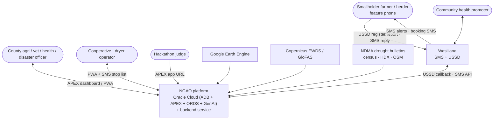
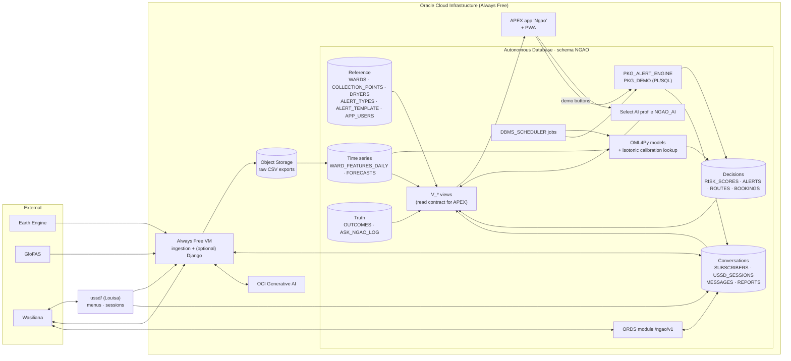
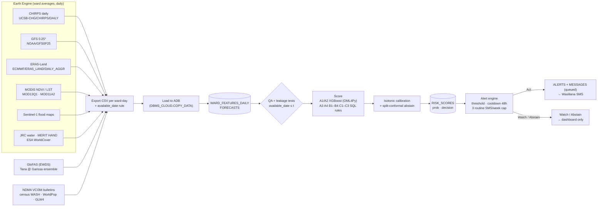
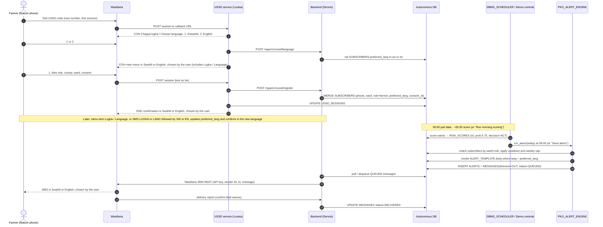
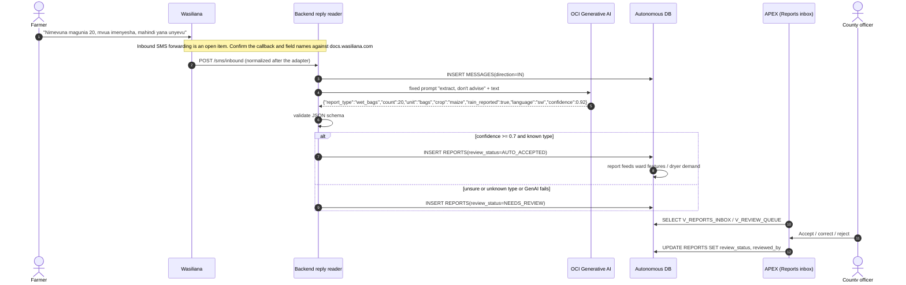
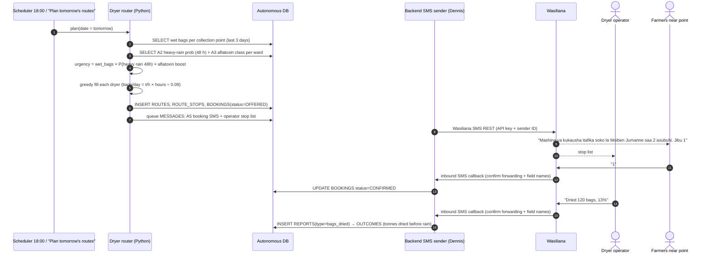
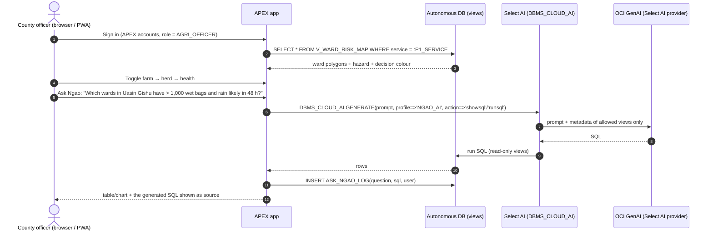
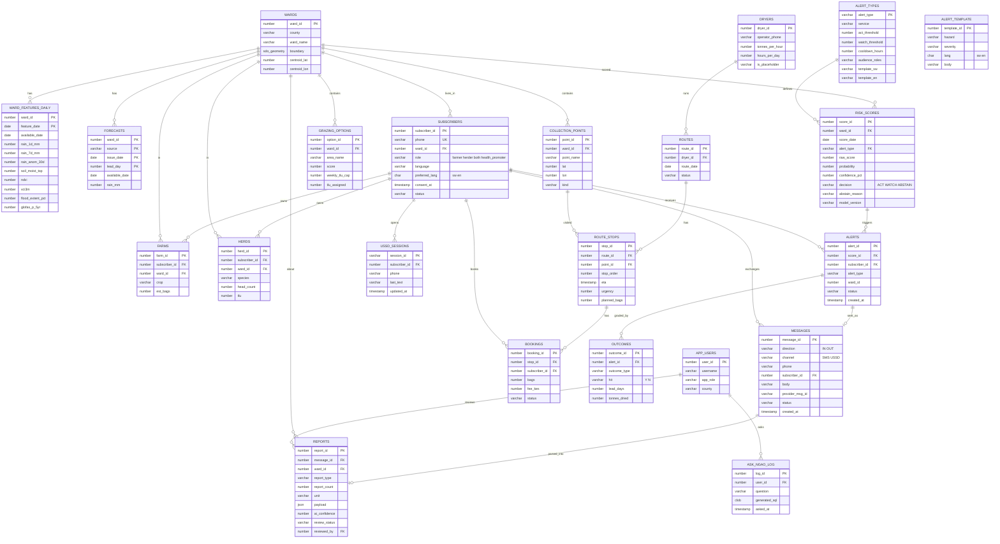

# Ngao / MvuaSmart: Architecture

> Source: *Ngao — Full Project Blueprint (MvuaSmart merged)*, 13 Oct 2026 (60 pp.), plus the original
> repo README. Items marked **[Assumption]** are design choices made for this repo, not stated in the brief.

## 1. Principles

1. **One Oracle Autonomous Database (ADB) is the single source of truth.** Data, scores, alerts,
   replies, dryer plans and outcomes all live in schema `NGAO`. Nothing to keep in sync.
2. **Integrate through the database, not through each other.** APEX (Chris) reads **views**; the
   backend (Dennis) **writes tables** and sends SMS. The USSD service (Louisa) owns menus and
   sessions and calls the backend's USSD contract for registration and reports. The contract is in
   [API_CONTRACT.md](API_CONTRACT.md).
3. **Models run next to the data.** OML4Py in-DB scoring (fallback: train in Python and write scores
   into tables), so scores are queryable by SQL, APEX and Select AI.
4. **Generative AI only reads.** OCI GenAI turns replies into JSON. Replies and outgoing messages are in
   Swahili or English, chosen by the user. Every outgoing message is a vetted per-language template
   (`ALERT_TEMPLATE`, selected by `preferred_lang`) with slots. AI never writes advice.
5. **Honest alerts.** Calibrated probability → **Act / Watch / Abstain**; cooldowns and caps; public scorecard.
6. **Leakage-safe replays.** Every feature row has `feature_date` and `available_date`; replays read
   only `available_date <= :t`.

## 2. Modules and responsibilities

| # | Module | Tech | Owner | Reads | Writes |
|---|---|---|---|---|---|
| M1 | Ingestion pipeline | Python, Earth Engine API, Copernicus EWDS, OCI Object Storage | **Trevor** | GEE, GloFAS, files | `WARD_FEATURES_DAILY`, `FORECASTS`, `WARDS` |
| M2 | Models & calibration | pandas, scikit-learn, XGBoost, OML4Py, SQL rules | **Trevor** (+ Chris for loading) | features | `RISK_SCORES` |
| M3 | Alert engine | PL/SQL (+ Python) | **Dennis** (wiring), Chris (tables) | `RISK_SCORES`, `ALERT_TYPES`, `ALERT_TEMPLATE`, `SUBSCRIBERS` | `ALERTS`, `MESSAGES` (queued) |
| M4 | SMS gateway | Wasiliana REST (API key + sender ID) + Django/DRF **or** ORDS. Optional client: `pytek-wasiliana` | **Dennis** | Wasiliana SMS API, delivery reports | `MESSAGES`, `SUBSCRIBERS` (STOP) |
| M4b | USSD menus | Wasiliana callback → `ussd/` | **Louisa** | Wasiliana session POST; backend `/ngao/v1/ussd/*` | `USSD_SESSIONS`; registration and reports via Dennis |
| M5 | Reply reader | OCI Generative AI (Cohere Command A) | **Dennis** | inbound `MESSAGES` | `REPORTS` (or review queue) |
| M6 | Dryer router | Python greedy plan (OR-Tools later) | **Dennis** (+ Trevor for simulation) | `REPORTS`, `RISK_SCORES`, `DRYERS`, `COLLECTION_POINTS` | `ROUTES`, `ROUTE_STOPS`, `BOOKINGS`, `MESSAGES` |
| M7 | Dashboard + PWA | Oracle APEX, APEX map region, PWA | **Chris** | `V_*` views | `REPORTS.review_status`, demo actions |
| M8 | Ask Ngao | Select AI (`DBMS_CLOUD_AI`) | **Chris** | views | `ASK_NGAO_LOG` |
| M9 | Scheduler & scorecard | `DBMS_SCHEDULER`, SQL | Chris / Dennis | `ALERTS`, `OUTCOMES` | `V_SCORECARD` |

## 3. System context

## 4. Component diagram

`VM` hosts the Django service **if** we keep Django (Dennis: SMS, alert engine, router, reply reader).
USSD callbacks always land on `ussd/` (Louisa), which calls the backend contract and writes
`USSD_SESSIONS`. SMS send and delivery reports stay on the backend (or ORDS, if that is the
[open decision](#open-decisions)). `pytek-wasiliana` is an optional Python client for the SMS API.

## 5. Data pipeline: GEE → ADB → OML scoring → alerts

Key dataset facts (from the brief, checked 13 Oct 2026): GFS rain totals = sum of forecast hours that
are multiples of 6; ERA5-Land rain in metres (×1000); NDVI × 0.0001; LST × 0.02 K. Availability lags:
GFS = run date; CHIRPS = 1st of next month + 25 d; ERA5-Land = +15 d; MODIS NDVI = composite start + 23 d;
MODIS LST = +13 d. Live "recent rain" therefore comes from previous GFS day-1 forecasts.

### Alert catalogue (seed rows for `ALERT_TYPES`)

| Code | Service | Trigger (starting rule) | Audience | Friday |
|---|---|---|---|---|
| A1 | MvuaSmart | P(3+ dry days starting ≤5 d) ≥ 70% | Farmers | **Live** |
| A2 | MvuaSmart | P(>20 mm/day within 48 h) ≥ 60% | Farmers, dryer operators | **Live** |
| A3 | MvuaSmart | Ward aflatoxin risk class high | Farmers, cooperatives | If time |
| A4 | MvuaSmart | P(cropland flood ≤3 d) ≥ 60% | Farmers | If time |
| A5 | MvuaSmart | Point chosen in tonight's route plan | Farmers near point | **Live** |
| B1 | Mifugo | >30% GloFAS members > 5-yr level | Herders, disaster officers | If time |
| B2 | Mifugo | P(flash flood ≤2 d) ≥ 60% | Herders, all | Designed |
| B3 | Mifugo | NDVI anomaly > +0.1 over 3 months after above-normal rain (NASA rule) | Herders, vets | **Replay** |
| B4 | Mifugo | Forecast VCI3M < 35 within 4–8 wk | Herders, committees, NDMA | Designed |
| C1 | Afya | Cholera conditions index high + flood / neighbour outbreak | Health teams, promoters | Static map if time |
| C2 | Afya | Same signal as B3 | Health teams | Replay |
| C3 | Afya | High ward aflatoxin risk after wet harvest | Food-safety officers, millers | Designed |

Decisions: **Act** = calibrated prob ≥ threshold and inputs agree → SMS + dashboard.
**Watch** = rising but below threshold → officers only. **Abstain** = GFS/ECMWF disagree, inputs
missing, or conformal set has both outcomes → officers, with reason.

Each subscriber stores `preferred_lang` (`sw` or `en`): Swahili or English, chosen by the user
(default `sw`). The alert engine renders the Act SMS from `ALERT_TEMPLATE`, one body per
`(hazard, severity, lang)`, using `lang` = `preferred_lang`. A later SMS of `LUGHA` or `LANG`
followed by `SW` or `EN` switches `preferred_lang` and sends a confirmation in the new language.
USSD changes the same column from the main-menu item **Lugha / Language**.

## 6. Sequence diagrams

### 6.1 Farmer USSD registration → morning SMS alert

### 6.2 Farmer SMS reply → GenAI parse → review queue → APEX

Fallback if parsing replies in Swahili or English, chosen by the user, is weak (brief risk): keyword + number matching, plus structured USSD
reports (menu 2) which skip the AI entirely.

### 6.3 Dryer booking / routing (18:00)

Fee shown in the SMS: (start − target moisture points) × ~KES 30 per 90 kg bag (NCPB rate; confirm).

### 6.4 Officer dashboard + Ask Ngao (Select AI)

## 7. Core schema (ER diagram)

Full DDL: [`db/schema.sql`](../db/schema.sql).

**[Assumption]** `FARMS`, `HERDS`, `ROUTE_STOPS`, `BOOKINGS`, `GRAZING_OPTIONS`, `APP_USERS`,
`ASK_NGAO_LOG`, `USSD_SESSIONS`, `FORECASTS`, `ALERT_TYPES` and `ALERT_TEMPLATE` refine the brief's table list
(WARDS, WARD_FEATURES_DAILY, RISK_SCORES, SUBSCRIBERS, ALERTS, REPLIES/REPORTS, DRYERS,
COLLECTION_POINTS, ROUTES, OUTCOMES). The brief's `REPLIES` = inbound rows in `MESSAGES`.

## 8. Security & data protection

- Store only phone, ward, role, and language preference (`preferred_lang`: Swahili or English, chosen by the user). **No GPS.** Consent at USSD registration; `STOP` unsubscribes.
- Health reports appear **aggregated by ward**, never by person (views enforce this).
- Kenya Data Protection Act 2019: register with ODPC before any real deployment.
- Secrets (Wasiliana API key, OCI keys) in `.env` / OCI Vault, never in git.
- Select AI profile is limited to `V_*` views; it can't reach `SUBSCRIBERS.phone`.
- Officers decide; Ngao advises.

## Open decisions

| # | Decision | Options | Recommendation (for discussion) | Owners |
|---|---|---|---|---|
| D1 | **Webhook/API runtime** | (a) **ORDS** REST handlers + PL/SQL, as the brief has it. (b) **Django/DRF** service, as the original README planned, writing to ADB via `python-oracledb` | Either honours this contract. ORDS has a public HTTPS URL out of the box and scores better on "Oracle adoption". Django is faster if Dennis already knows it. A hybrid also works: Django for Wasiliana SMS webhooks + GenAI, PL/SQL for the alert engine. USSD menus stay in `ussd/` either way | Chris + Dennis, **Wed** |
| D2 | Django hosting (if D1=b), and the public URL for the USSD callback | OCI Always Free VM + HTTPS, or ngrok tunnel for demo | VM on OCI (Oracle adoption), tunnel as backup | Dennis (API host), Louisa (USSD callback URL) |
| D3 | OML4Py on Always Free | in-DB XGBoost vs Python-trained scores loaded to table | Check day one; fallback is fine | Trevor + Chris |
| D4 | Map rendering in APEX | Native Map region (GeoJSON/SDO) vs static choropleth | Native Map region | Chris |
| D5 | Who sends SMS | backend dequeues `MESSAGES` and calls the Wasiliana REST API (API key + sender ID) vs PL/SQL calls Wasiliana via `APEX_WEB_SERVICE` | Backend dequeues (one sender). Louisa does not send SMS. Optional client: `pytek-wasiliana` | Dennis |
| D6 | OCI region / services availability (GenAI, Select AI) | n/a | Check home region on first sign-in | Chris |
| — | **Inbound SMS forwarding** | Confirm with Wasiliana whether inbound SMS is POSTed to our callback, and the exact field names, at [docs.wasiliana.com](https://docs.wasiliana.com). Delivery-report field names are the same check | Do not code the reply reader against guessed fields. One adapter normalizes the body | Dennis |
