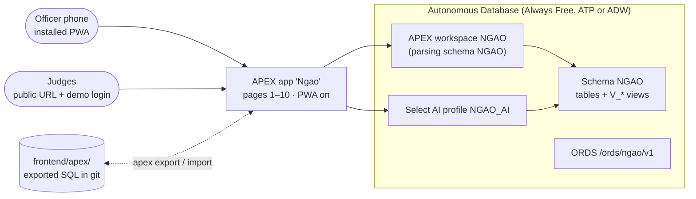

# Oracle APEX, Autonomous DB & Select AI: how we use them

Owner: **Chris** (`frontend-chris`): APEX dashboard + PWA. Account: Strathmore OCI tenancy user `christopherkioko`
(set up 13 Oct 2026, no credit card). **Check your home region on first sign-in**: Always Free
resources are created in the home region, and OCI GenAI / Select AI provider availability depends on region.



## 1. Setup (Tuesday night / Wednesday morning)

1. OCI Console → **Oracle Database → Autonomous Database → Create** → *Always Free* ✔, workload *Transaction Processing* (or Data Warehouse), name `ngaodb`. Note the ADMIN password (never commit it).
2. **Database Actions → Database Users → Create user `NGAO`**: enable *Web Access* (ORDS REST) and grant quota. Grant `DBMS_CLOUD`, `DBMS_CLOUD_AI` execute.
3. Run [`db/schema.sql`](../db/schema.sql) as `NGAO` in **SQL Worksheet**.
4. **APEX → Administration Services → Create Workspace** `NGAO` on existing schema `NGAO`; create the workspace admin and a developer account for Chris. Dennis and Trevor need SQL Worksheet access on schema `NGAO` for SMS tables and OML4Py. Louisa reaches subscribers through the USSD contract, not through APEX.
5. Load ward boundaries (HDX, CC-BY) into `WARDS.boundary` (GeoJSON → `SDO_UTIL.FROM_GEOJSON`).
6. Day-one check: **does OML4Py work on Always Free?** (OML Notebooks → `%python import oml`). If not, train in Python and load scores into `RISK_SCORES`.

## 2. Pages → views

| # | Page | Users (APEX role) | Source view(s) | Key components |
|---|---|---|---|---|
| 1 | **Ward risk map** (home) | all officers | `V_WARD_RISK_MAP`, `V_KPI` | **Map region** (polygon layer from `boundary_geojson`), select list `P1_SERVICE` = FARM/HERD/HEALTH, `P1_ALERT_TYPE`, date picker; colour by `decision` (Act red, Watch amber, Abstain grey + tooltip reason) |
| 2 | **Wet maize & dryer planner** | AGRI_OFFICER, OPERATOR, COOP | `V_WET_MAIZE_POINTS`, `V_DRYER_PLAN` | Map points sized by wet bags; interactive grid of tomorrow's stops; button "Plan tomorrow's routes" |
| 3 | **Reports inbox / review queue** | all officers | `V_REPORTS_INBOX`, `V_REVIEW_QUEUE` | Map + Interactive Report; review tab with Accept / Correct / Reject (form updates `REPORTS`) |
| 4 | **Vet priority list** | VET | `V_VET_PRIORITY` | Ranked IR, RVF Watch shows **before** herder Act |
| 5 | **Health watch list** | HEALTH | `V_HEALTH_WATCH` | Aggregated by ward only |
| 6 | **Drought & grazing** | NDMA, COMMITTEE | `V_DROUGHT_GRAZING` | VCI3M line chart, options with herd caps |
| 7 | **Scorecard** (public) | public | `V_SCORECARD`, `V_CALIBRATION` | Hit rate, false alarms, avg warning time (headline), calibration chart; page auth = *public* |
| 8 | **Garissa 2006 RVF replay** | all | `V_RVF_REPLAY` | Date slider / animated map (fallback: static before/after) with first case 30 Nov, peak 24 Dec, vaccination 8 Jan 2007 |
| 9 | **Ask Ngao** | officers | Select AI over `V_*` | Text area → `DBMS_CLOUD_AI.GENERATE`, show SQL + result, log question |
| 10 | **Demo controls** (hidden) | ADMIN only | n/a | Buttons: Run morning scoring · Send alerts · Plan tomorrow's routes · Run replay · Reset demo → `PKG_DEMO` / REST §2.2 |
| 11 | **Subscriber admin** | ADMIN | `SUBSCRIBERS` | Interactive report of subscribers with an editable `preferred_lang` (`sw` / `en`) |

Pages 1–3 + 10 are needed for the live demo; 7–8 for the honest-replay story; 9 is **first on the cut list**.

### Kiswahili / English toggle

The dashboard has a **Kiswahili / English** toggle so officer-facing text is in Swahili or English, chosen by the user. Implement it in either of these ways:

- a **translated application** (primary language plus a Kiswahili translation, switched from the navigation bar), or
- a **session language item** (application item `APP_LANG` with values `sw` and `en`, set by a select list in the navigation bar; page text and labels follow that item).

This toggle is the officer's UI language. It does not change a farmer's SMS language. That value is `SUBSCRIBERS.preferred_lang`, edited on the subscriber admin page (page 11).

## 3. Map region notes
- APEX 23.1+ Map region supports polygon layers from SDO_GEOMETRY or GeoJSON columns. Use `V_WARD_RISK_MAP` with a `colour` column and set *Fill Color* = `&COLOUR.`.
- Add a second points layer for `REPORTS` (ward centroid; **no personal GPS**) and collection points.
- Refresh the region via Dynamic Action after demo buttons run (so judges see the report "pop onto the map").

## 4. Select AI (Ask Ngao)

```sql
-- once, as ADMIN: allow outbound to OCI GenAI and create credential (resource principal or API key)
BEGIN
  DBMS_CLOUD_AI.CREATE_PROFILE(
    profile_name => 'NGAO_AI',
    attributes   => '{"provider":"oci",
                      "credential_name":"OCI_GENAI_CRED",
                      "object_list":[{"owner":"NGAO","name":"V_WARD_RISK_MAP"},
                                     {"owner":"NGAO","name":"V_WET_MAIZE_POINTS"},
                                     {"owner":"NGAO","name":"V_VET_PRIORITY"},
                                     {"owner":"NGAO","name":"V_SCORECARD"},
                                     {"owner":"NGAO","name":"V_REPORTS_INBOX"}],
                      "comments":true}');
END;
/
-- in the APEX page process:
SELECT DBMS_CLOUD_AI.GENERATE(prompt => :P9_QUESTION, profile_name => 'NGAO_AI', action => 'showsql') FROM dual;
```
Add `COMMENT ON COLUMN` to the views so the model picks the right columns. Demo questions:
- "Which wards in Uasin Gishu have more than 1,000 wet bags and rain likely in the next 48 hours?"
- "List Garissa wards where Rift Valley fever risk rose this week."
- "How many alerts did we send this month, and how many came true?"

Safety (brief's Ask Ngao rules): answers come only from these views; show the SQL as the source; log every question in `ASK_NGAO_LOG`; refuse pesticide/medical questions (point to an extension officer).
**[Assumption: verify]** exact credential/provider attributes vary by ADB version and region; follow the current Oracle Select AI docs.

## 5. PWA (phone app for officers, cooperatives, operators)
*Shared Components → Progressive Web App*: **Enable Progressive Web App = On**, **Installable = On**, set
name "Ngao", short name "Ngao", theme colour, 192/512 px icons (store in `frontend/pwa/`). Users open
the app URL in Chrome/Safari → *Install*. No app store, no separate code. Farmers stay on SMS/USSD.
Use the Universal Theme with mobile-friendly page templates; test pages 1–3 at phone width.

## 6. Authentication & roles
- Authentication scheme: **Oracle APEX Accounts** (fast for hackathon). Later: OCI IAM / social sign-in.
- Authorization schemes (APEX ACL roles): `ADMIN`, `AGRI_OFFICER`, `VET`, `HEALTH`, `DISASTER`, `COOP`, `OPERATOR`, `COMMITTEE`.
- Page 7 (scorecard) public; page 10 `ADMIN` only and not in navigation.
- Create a **judge demo login** (read-only role) and put it in the submission email, not in git.

## 7. Version control: exporting the app into git
Never hand-edit exported files. Export after every working session on `frontend-chris`:

```bash
# SQLcl (recommended): split export, readable diffs
sql NGAO/<pwd>@ngaodb_high <<'SQL'
apex export -applicationid 100 -split -skipExportDate -dir frontend/apex
SQL
git add frontend/apex && git commit -m "apex: export app 100"
```
Alternative: *App Builder → Export/Import → Export* (SQL file) → save as `frontend/apex/f100.sql`.
Import on a fresh workspace: *App Builder → Import* (or `@frontend/apex/f100/install.sql` in SQLcl).
DB objects live in `db/` (not in the APEX export).

## 8. Deployment URL for judges
`https://<adb-id>-ngaodb.adb.<region>.oraclecloudapps.com/ords/r/ngao/ngao/home` (format for APEX friendly
URLs; copy the real one from *Run Application*). Put it in the submission email and README once live.

## 9. Always Free notes
- 2 Always Free ADB instances per tenancy, 1 OCPU, 20 GB each: our data is < 1 GB.
- **An idle Always Free ADB is stopped after 7 days** and can be reclaimed later: open it before Friday.
- Always Free ADB caps concurrent sessions: fine for a demo, avoid load tests.
- OCI Generative AI is **not** Always Free: small cost per call (short reply parses); keep within credits.
- Always Free compute VM (for ingestion / Django) available in the home region.
